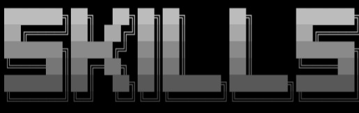

# holoscan-my-NVIDIA-module 

# NVIDIA-Nemotron-3.5-Transcribe-30B-A4B

<div align="center" style="line-height: 1;">
  <a href="https://developer.nvidia.com/nemotron" target="_blank" style="margin: 2px;">
    
  </a>
  <a href="https://github.com/NVIDIA-NeMo/Speech" target="_blank" style="margin: 2px;">
    
  </a>
  <a href="https://research.nvidia.com/labs/nemotron/files/NVIDIA-Nemotron-3.5-Transcribe-Technical-Report.pdf" target="_blank" style="margin: 2px;">
    
  </a>
  <a href="https://huggingface.co/spaces/nvidia/nemotron-transcribe" target="_blank" style="margin: 2px;">
    
  </a>
  <a href="https://sgl-project.github.io/sglang-omni/cookbook/nemotron_transcribe.html" target="_blank" style="margin: 2px;">
    
  </a>
  <a href="https://huggingface.co/datasets/nvidia/Granary-v2" target="_blank" style="margin: 2px;">
    
  </a>
  <a href="https://discord.gg/9xpKQtVvrk" target="_blank" style="margin: 2px;">
    
  </a>
</div> 

---



---
# Module Identity 
(`metadata.json`) in my repository root to match my official module identity:
```JSON
{
  "module": {
    "name": "holoscan-my-NVIDIA-module",
    "display_name": "My NVIDIA Holoscan Module",
    "version": "1.0.0",
    "description": "NVIDIA Holoscan 5.0 Sensor Fusion Module (Camera 60Hz + High-Rate IMU)",
    "authors": ["Md Abul Hossain"],
    "affiliation": "Taru Global Access",
    "license": "Apache-2.0",
    "contact_email": "harigov63@gmail.com",
    "source_repository": "https://github.com/AnticipatedD/holoscan-my-NVIDIA-module",
    "cpp": {
      "namespace": "holoscan::my_nvidia_module"
    },
    "python": {
      "namespace": "holoscan_my_nvidia_module"
    },
    "holoscan_sdk": {
      "minimum_required_version": "5.0.0"
    }
  }
}
```
# Sensor Fusion Operator Header 
(`operators/fusion_op/fusion_op.hpp`)

This operator implements the multi-rate contract between the 60 Hz Camera source and high-rate IMU source: 
```
#pragma once

#include <cstdint>
#include <holoscan/core/errors.hpp>
#include <holoscan/core/execution_context.hpp>
#include <holoscan/core/expected.hpp>
#include <holoscan/core/operator.hpp>
#include <holoscan/core/operator_spec.hpp>
#include <holoscan/core/port.hpp>

namespace holoscan::my_nvidia_module {

class FusionOp final : public holoscan::Operator<> {
 public:
  // Typed inputs matching the 60Hz Camera frame & high-rate IMU payload
  holoscan::Input<std::uint32_t> camera_in;
  holoscan::Input<std::uint32_t> imu_in;
  holoscan::Output<std::uint32_t> control_out;

  void setup(holoscan::OperatorSpec& spec) override;
  [[nodiscard]] holoscan::expected<void, holoscan::Error> compute(
      holoscan::ExecutionContext& context) override;
};

}  // namespace holoscan::my_nvidia_module 
```
# Sensor Fusion Operator Source 
(`operators/fusion_op/fusion_op.cpp`)
```
#include "fusion_op/fusion_op.hpp"
#include <holoscan/core/expected_macros.hpp>

namespace holoscan::my_nvidia_module {

void FusionOp::setup(holoscan::OperatorSpec& spec) {
  spec.input(camera_in, "camera_in");
  spec.input(imu_in, "imu_in");
  spec.output(control_out, "control_out");
}

holoscan::expected<void, holoscan::Error> FusionOp::compute(
    holoscan::ExecutionContext&) {
  // Receive camera frame and high-rate IMU payload
  HOLOSCAN_TRY(auto cam_frame, camera_in.receive_data());
  HOLOSCAN_TRY(auto imu_data, imu_in.receive_data());

  // Sensor fusion logic driving the control output
  std::uint32_t fused_control_command = cam_frame + imu_data;

  return control_out.emit(fused_control_command);
}

}  // namespace holoscan::my_nvidia_module 
```
# C++ Pipeline Application 
(`applications/first_pipeline/cpp/main.cpp`)
```
#include <iostream>
#include <holoscan/core/compile.hpp>
#include <holoscan/core/graph.hpp>
#include <holoscan/core/run.hpp>
#include <holoscan/time/realtime_clock.hpp>

#include <fusion_op/fusion_op.hpp>

int main() {
  holoscan::Graph graph{"camera_imu_fusion_pipeline"};

  // Instantiate the fusion operator
  const auto fusion = graph.op<holoscan::my_nvidia_module::FusionOp>("fusion_op");

  // Set default realtime clock to drive the multi-rate graph
  graph.set_default_clock(graph.add_clock<holoscan::RealtimeClock>("clock"));

  // Compile the graph into an execution plan
  const holoscan::ExecutionPlan plan = holoscan::compile(graph);
  if (!plan.ok()) {
    std::cerr << "Graph compilation failed:\n" << plan.json() << '\n';
    return 1;
  }

  // Execute the sensor-fusion pipeline
  return holoscan::run(plan);
} 
```
---
Copyright © 2026 Md Abul Hossain. All Rights Reserved.
